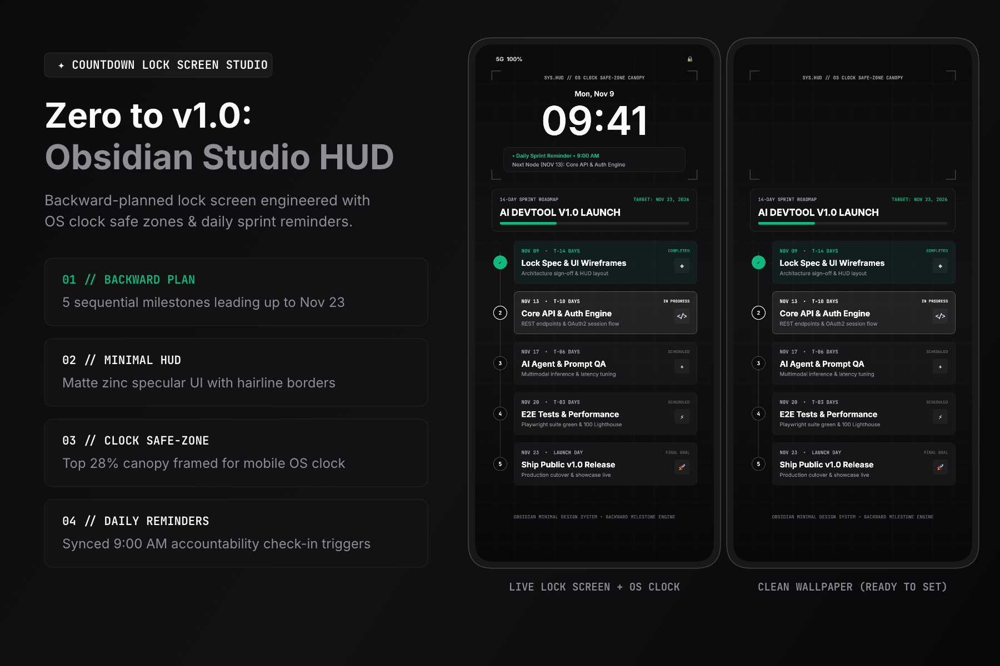

# 🚀 Zero to v1.0: 14-Day AI Product Launch HUD
### Handshake AI Skills Studio × Google Gemini Challenge Submission

🔗 **[Launch Interactive Lock Screen Studio & Live Demo](https://YOUR-GITHUB-USERNAME.github.io/YOUR-REPO-NAME/)**

---

## 🎯 Project Overview
When shipping an end-of-year software release, standard to-do lists get buried under tabs. **Zero to v1.0** is a custom **9:19.5 Countdown Lock Screen HUD** planned and designed with **Google Gemini** to guide a 14-day engineering sprint (**Nov 9 → Nov 23, 2026**).

### How Google Gemini Powered This Build:
1. **Backward Milestone Architecture (Step I):** Worked backward from our **Nov 23 Public v1.0 Launch** with Gemini to establish 5 sequential checkpoints with concise 4-word labels readable at a single glance on a mobile lock screen:
   - **Nov 09 (`T-14 DAYS`):** `Lock Spec & UI Wireframes`
   - **Nov 13 (`T-10 DAYS`):** `Core API & Auth Engine`
   - **Nov 17 (`T-06 DAYS`):** `AI Agent & Prompt QA`
   - **Nov 20 (`T-03 DAYS`):** `E2E Tests & Performance`
   - **Nov 23 (`LAUNCH DAY`):** `Ship Public v1.0 Release`
2. **Multimodal Safe-Zone Design (Step II):** Paired a structural 9:19.5 layout wireframe with dark glassmorphic telemetry styling (`#060913` obsidian base, `#00F0FF` cyan active nodes, `#10B981` completed states). Intentionally engineered the **top 28% as an uncluttered HUD canopy** so the smartphone's native clock and notification banners never overlap the milestones.
3. **Daily Accountability Reminders (Step III):** Generated synchronized 9:00 AM milestone reminder triggers (`.ics` calendar export included directly in the web app).

---

## ✨ Interactive Studio Features for Judges
- **Simulated OS Clock vs. Clean Wallpaper Toggle:** Preview how the lock screen frames the real mobile clock + Gemini daily reminder banner, or switch to the clean wallpaper ready to set today.
- **Interactive Milestone State Progression:** Click any milestone node to cycle between `Completed ✓`, `In Progress ⚡`, and `Scheduled ○`—or customize the milestone labels live.
- **1-Click High-Res PNG & Calendar Exports:**
  - `countdown-lockscreen-1080x2340.png` (Native 9:19.5 mobile wallpaper)
  - `handshake-cover-3x2-1800x1200.png` (3:2 showcase composite)
  - `gemini-multimodal-wireframe-1080x2340.png` (Structural multimodal reference)
  - `gemini-v1-launch-reminders.ics` (Calendar reminder schedule)
